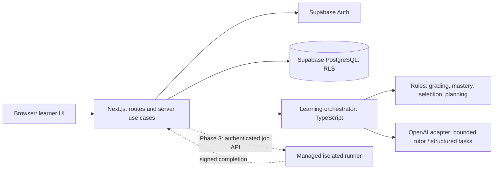

# Technical architecture

Status: proposed full-system architecture, 2026-10-21. The initial empty-repository inspection is historical. A later authorized frontend foundation now uses Next.js App Router, typed fixtures in `src/data/mock`, shared components, and small client feature modules. One React context shares temporary preferences; other state stays local. Current routes are `/dashboard`, `/career-paths`, `/learn`, `/learn/[topicSlug]`, `/lessons/[lessonId]`, `/practice`, `/progress`, and `/settings`. `/` redirects to the dashboard.

The frontend uses public demonstration answers and local feedback, not private assessment keys or the production grading/mastery flow below. There are no server use cases, API integrations, database migrations, AI calls, or execution services yet. Dependency installation and runtime verification are pending; see DEVELOPER_GUIDE.md. The original proposed structure below remains a guide for later authorized features, not an inventory of existing directories.

## Decisions and boundaries

Use one Next.js App Router application with TypeScript, Tailwind CSS, and shadcn/ui. Deploy on Vercel; use Supabase PostgreSQL and Authentication. Call OpenAI from server-only modules through the official TypeScript SDK and Responses API. Use Monaco only in Phase 3. Keep GitHub for source and CI. Pin supported versions and a lockfile at implementation time; this plan does not assert installed dependencies.

This is a modular monolith: UI, use cases, data access, and learning logic have explicit boundaries inside one repository and deployment. No separate backend, autonomous agent runtime, message broker, vector database, or ORM is needed for Phase 1. SQL migrations and generated Supabase database types provide the data contract. Add an external managed execution boundary and durable job handling only when executable practice requires them.



The orchestrator calls modules; it is not a second service. Browser-to-Supabase access is limited to authentication and explicitly permitted owner data. Authoritative quiz, mastery, content-publication, AI-budget, and execution writes go through validated server workflows/RPCs. RLS and grants must still reject forged direct Data API calls.

## Frontend and proposed repository structure

Server Components load library/dashboard data through a request-scoped data-access layer. Client Components implement forms, quiz interaction, chat, and later the editor. Keep render functions free of grading and persistence policy. Do not add a global state library initially: URL search parameters handle library filters; local state handles transient inputs; the database holds durable progress. Client polling is sufficient for Phase 3 execution results initially.

Proposed structure below is a recommendation; directories are not being scaffolded in this planning task. Future-only modules should be added when their phase begins.

```text
/
  PRD.md
  ARCHITECTURE.md
  DATABASE_SCHEMA.md
  DEVELOPMENT_ROADMAP.md
  AGENTS.md
  src/
    app/
      (public)/page.tsx
      (auth)/login/page.tsx
      (auth)/signup/page.tsx
      (auth)/forgot-password/page.tsx
      (auth)/reset-password/page.tsx
      auth/callback/route.ts
      (app)/layout.tsx
      (app)/onboarding/page.tsx
      (app)/dashboard/page.tsx
      (app)/learn/[topicSlug]/page.tsx
      (app)/lessons/[lessonId]/page.tsx
      (app)/practice/page.tsx
      (app)/tutor/page.tsx
      (app)/history/page.tsx
      (app)/settings/page.tsx
      api/                         # HTTP contracts listed below
      globals.css
    components/
      ui/                          # shadcn primitives
      layout/                      # navigation and page shell
      learning/                    # lesson and quiz UI
      charts/                      # accessible evidence summaries
    features/
      auth/
      onboarding/
      curriculum/
      practice/
      progress/
      tutoring/                    # schemas, UI, server use cases
      planning/                    # Phase 2
      assessments/                 # Phase 2 diagnostic; Phase 3 mocks
      execution/                   # Phase 3 adapter, no local execution
    server/
      auth/                        # identity and authorization helpers
      dal/                         # owner-scoped queries and safe DTOs
      learning/                    # orchestrator and deterministic rules
      ai/                          # provider adapter, prompts, budgets
      jobs/                        # Phase 2/3 durable work handlers
      observability/               # redacted events and request IDs
    lib/
      supabase/                    # browser/server client factories
      validation/                  # shared input/output schemas
      dates/                       # UTC persistence, timezone conversion
    types/database.generated.ts
  content/                         # validated lesson/question imports
  supabase/
    migrations/
    seed.sql                       # reviewed seed data; no credentials
    tests/                         # SQL constraints, RPC, RLS tests
  tests/
    unit/
    integration/
    e2e/
    evals/                         # fixtures/rubrics, not an agent framework
  scripts/                         # content validation/import, generated types
  public/
  .env.example                     # names/placeholders only
  .github/workflows/ci.yml
```

Place `server-only` guards on AI, privileged Supabase clients, answer-key access, and other sensitive modules. Auth refresh uses the current framework-supported request boundary (for example `proxy.ts` where applicable); its location and implementation follow the pinned Next.js/Supabase versions. It is not the sole authorization layer.

## Backend, identity, and data access

Use Supabase Auth email/password with confirmation and password recovery. Use the supported `@supabase/ssr` cookie clients and verified claims/user lookup per the installed SDK guidance; do not authorize from an unverified locally decoded session. Follow the official [Supabase SSR guide](https://supabase.com/docs/guides/auth/server-side/nextjs). Restrict auth callback URLs and relative post-login destinations. Refresh cookies where the framework permits writes. Test expired sessions, callback failures, and revoked users; require recent authentication for deletion.

Every Route Handler and Server Action verifies identity and resource authorization, validates inputs, and invokes one use case. Layout redirects and hidden buttons are convenience controls. Centralize these checks in a server data-access layer as recommended by the [Next.js authentication guide](https://nextjs.org/docs/app/guides/authentication). Use explicit safe DTOs rather than returning database rows wholesale.

Use ordinary user-scoped Supabase clients for owner reads and permitted preference writes. Server-only trusted operations access private keys and execute atomic grading RPCs. Prefer a dedicated least-privilege database role or tightly scoped functions. If a Supabase secret/service-role client is used, it bypasses RLS and therefore must be restricted to small server adapters with explicit verified user IDs, never a general-purpose client in request code. No privileged key is prefixed `NEXT_PUBLIC_`.

Database schema, indexes, ownership constraints, grants, and policy matrix are in [DATABASE_SCHEMA.md](DATABASE_SCHEMA.md). Use PostgreSQL transactions/RPCs for coupled writes; several sequential REST writes are not an atomic transaction. Cache published curriculum by version, and invalidate on publication. Never place private responses in a shared cache or rely on framework defaults for user-specific caching. Set appropriate no-store/private behavior and test with two users.

## HTTP and server-use-case contracts

Server Components call read use cases directly instead of making HTTP requests back to the same app. Server Actions handle preference forms using the same validation/use cases. Use Route Handlers for interactive quiz mutations, chat streaming, deletion, and future jobs. Do not implement both a Server Action and handler for the same mutation without a concrete caller.

| Phase | Contract | Behavior |
| --- | --- | --- |
| 1 | Supabase auth + `GET /auth/callback` | Managed signup/login/reset; verify callback and redirect allowlist |
| 1 | `saveOnboarding`, `updateSettings` server actions | Paths, primary path, timezone, interview date; infer user from verified session |
| 1 | `GET /api/topics`, `GET /api/topics/:id/lessons` | Published safe content; optional bounded filters |
| 1 | `PUT /api/lessons/:id/progress` | Validate owner and published lesson version; activity only |
| 1 | `POST /api/practice/assignments` | Select reviewed item; create server-owned draft attempt and return safe prompt/options |
| 1 | `POST /api/attempts/:id/hint` | Record assistance before returning hint; repeated calls are idempotent |
| 1 | `POST /api/attempts/:id/submit` | Validate response; grade from private key; atomically finalize attempt and update mastery |
| 1 | `POST /api/attempts/:id/solution` | Record exposure before disclosure; block during protected assessments |
| 1 | `POST /api/conversations` | Create owned conversation with optional authorized topic/lesson |
| 1 | `POST /api/conversations/:id/messages` | Persist user turn; reserve budget; stream tutor text; persist final/failed state |
| 1 | `GET /api/conversations/:id/messages` | Paginated authorized history and interruption recovery |
| 1 | `DELETE /api/conversations/:id`, `DELETE /api/account` | Idempotent owned deletion; fresh authentication for account deletion |
| 1 | `GET /api/progress`, `GET /api/history` | Evidence summaries and bounded cursor pagination |
| 2 | `POST /api/assessments/diagnostic`, `POST /api/assessments/:id/finish` | Freeze assignment and complete a diagnostic once |
| 2 | `POST /api/job-descriptions`, `POST /api/job-descriptions/:id/analyze` | Consent, size limits, schema-constrained topic extraction |
| 2 | `POST /api/study-plans/rebuild`, `GET /api/reviews` | Version a deterministic plan; compute due queue from database |
| 2 | `POST /api/reviews/:id/submit` | Grading plus mastery and review-state transition in one transaction |
| 3 | `POST /api/executions`, `GET /api/executions/:id` | Create idempotent job; return 202 and status; rate-limit polling |
| 3 | `POST /api/internal/executions/callback` | Validate provider signature/timestamp and deduplicate completion |
| 3 | `POST /api/assessments/mock`, `PUT /api/assessments/:id/responses` | Server deadline, immutable item versions, autosave |
| 3 | `POST /api/interview-simulations`, `GET /api/reports/:id` | Text simulation workflow and evidence-based report |

Mutation requests carry an idempotency UUID and canonical input hash where retries could duplicate work. Reuse with a different payload returns 409. Return 400/422 for invalid input, 401 for no valid session, 404 for unavailable or non-owned resources, 409 for invalid state/replay conflict, 429 for limits with retry guidance, and 503 for temporary provider failure. Do not leak existence through ownership errors. JSON errors use `{error: {code, message, requestId}}`; chat sends corresponding stream error/final events after headers have been sent. Validate origin/CSRF protection on cookie-authenticated route mutations and Server Actions; keep CORS same-origin by default.

## Learning orchestrator and AI capabilities

Implement `LearningOrchestrator` as ordinary typed use cases. Authentication, policy, context retrieval, grading, persistence, and budget approval remain application responsibilities. Models have no arbitrary database access or authority to update scores. No multi-agent framework, self-directed loops, agent handoffs, or agent-to-agent conversation is needed.

| Capability | Implementation | Allowed outputs / authority |
| --- | --- | --- |
| Tutor Agent | One bounded AI call using selected published lesson/topic and a short owned conversation window | Explanations, examples, hints; cannot grade, publish, run code, or write mastery |
| Practice Agent | Phase 1 deterministic reviewed-bank selection; Phase 2 offline AI draft generation behind validation/review | Draft question payloads; only a trusted publication workflow makes items available |
| Assessment Agent | Answer-key comparison first; Phase 3 trusted executable test results; optional rubric-based AI feedback for prose | Deterministic numeric outcomes; subjective AI feedback is separate and cannot independently raise mastery |
| Study Planner Agent | Phase 2 deterministic prioritization and capacity allocation; optional AI wording of an already validated plan | Feasible plan items persisted by application logic; AI cannot change schedule or priority constraints |

### Submission flow and consistency

1. Server creates an owned attempt bound to an immutable published question version and optional assessment item. It sends no key or private explanation.
2. Hints/solutions are separate authenticated operations that mark exposure before returning content. Tutor help for an active item also marks assistance. Do not claim to detect help obtained elsewhere.
3. Submit validates state, ownership, question type/options, idempotency key/hash, and any server deadline. Accept only the response, never a client-supplied grade, mastery value, or effective timestamp. Check prior same-day attempts and assistance across the logical question, so opening a fresh attempt cannot erase known hints or solution exposure.
4. One database transaction locks the attempt, reads the private key, writes the score and evidence eligibility, appends the mastery event, and recomputes the topic projection using the PRD algorithm. Lock per user/topic to serialize concurrent evidence updates; enforce one eligible attempt per user/logical question/UTC day. Hint/solution operations use the same locking boundary so exposure cannot race grading.
5. Commit before returning feedback or revalidating the dashboard. On network retry, return the committed result without adding evidence. Grade corrections append a correction event and recompute rather than silently changing history.

Phase 2 reviews add their schedule/event changes to this transaction. Unfinished, abandoned, or runner-failed attempts cannot become wrong-answer evidence by default.

### Adaptive planning and review rules, Phase 2

Start with a versioned deterministic algorithm. Estimate remaining lesson/practice minutes from reviewed curriculum, validate prerequisites, and rank eligible topic work by normalized components: 40% skill gap (`1 - estimate`, with explicit unassessed handling), 25% confirmed job relevance (or primary-path relevance when no job exists), 20% due-review urgency, and 15% prerequisite importance. These weights are starting product choices, not validated pedagogy. First satisfy prerequisite ordering; then allocate tasks into the learner's available local dates with daily capacity. Date pressure reduces selected scope; it must not increase daily capacity behind the user's back. Show why each task was selected and unallocated minutes when infeasible. Handle dates in the past, no available days, overlapping paths, and no matching content explicitly.

Use a simple versioned review schedule first: successful independent reviews progress through 1, 3, 7, 14, and 30 days; incorrect or assisted reviews reset to 1 day. Schedule local review dates in the saved IANA timezone and store the derived UTC due timestamp. Record the actual timezone and algorithm on each schedule transition. Cap today's review allocation by available minutes, carrying overdue work without duplicating cards. Every review records its attempt and previous/new interval. Cron is unnecessary for an in-app queue; query due work on access. Email reminders and a more sophisticated retention model can be evaluated later.

Difficulty starts at easy with sparse evidence, moves to medium at estimate >=0.6 with at least five distinct questions, and to hard at >=0.8 with at least ten distinct questions; lower it one band when the last five eligible attempts average below 0.5. All changes are bounded by reviewed bank availability. Maintain these rules as versioned functions, not prompt instructions.

## OpenAI integration, quality, and spending

Use Responses API through a small `AiProvider` interface with explicit model, timeout, token ceiling, prompt version, and trace/request ID. Model IDs and token prices are configuration, selected against a local evaluation set during Phase 1, not invented or pinned to a presumed current model here. The tutor streams text; job extraction and draft generation use schema-constrained outputs plus domain validation. Structured output guarantees do not establish factual correctness, and refusals/incomplete responses need handling; see [official Structured Outputs guidance](https://developers.openai.com/api/docs/guides/structured-outputs).

Initial proposed application limits (configurable and verified before beta): 20 tutor generations per user per UTC day, 2 concurrent calls per user, 2,000 characters per new message, a hard 6,000-input-token context cap, 800 maximum output tokens, and a 30-second provider deadline inside the configured route duration. Tokenization includes instructions, retrieved text, history, user input, and provider framing; reserve conservatively and reject requests that cannot fit after trimming old history. No unlimited chat or recursive tool use. Permit at most one bounded retry for transient failures before any response text is delivered; do not automatically repeat partial streams. Reserve the retry's maximum cost too. Return reviewed lesson links on failure or quota exhaustion. Serialize turn admission within each conversation and allocate message sequence numbers under a lock; return a clear busy state for overlapping turns rather than corrupting context. A conversation may bind an owned active practice attempt; record tutor assistance before generating help.

Track each generation in `ai_requests`: user, capability, idempotency key/hash, model, prompt version, timing, status, provider request ID, token counts, and estimated/actual cost. The server atomically locks global monthly and per-user daily budget buckets and reserves a conservative maximum before calling the provider. Reconcile actual usage after completion; on unknown usage, retain the reservation until reconciliation or an operator resolves it. A stale lease must not silently release potentially incurred cost. Retry/reconnect of the same request reuses its ledger record. Include cached-input rates only when confirmed by provider usage; default to the conservative uncached estimate.

Cost estimate in USD: `(input_tokens * input_price_per_million + output_tokens * output_price_per_million) / 1,000,000`, using current configured rates and counting provider-reported billed output categories. Persist the rate snapshot/version and use fixed-precision numbers. At 50 beta users and 20 calls/day, the maximum is 1,000 calls/day; at the proposed token ceilings that is approximately 6 million input and 0.8 million output tokens/day before reserved retries. This is an illustrative upper-bound planning scenario, not a usage forecast or a price quote. Set a numeric `AI_MONTHLY_BUDGET_USD` before enabling production AI; fail closed if absent or reached. Use provider project alerts/limits as an additional guard, not the application enforcement mechanism. Cache only reviewed public explanations; never share personalized prompts/responses between users.

### Grounding and prompt injection

Retrieve by authorized topic/lesson identifiers with SQL first. Send only the selected published excerpts and recent owned history; no embeddings are needed for eight topics. Treat messages, job descriptions, code, and retrieved text as untrusted data. Separate instructions from quoted source material. Do not give the model secrets, database credentials, hidden assessment keys, network tools, or unrestricted SQL. Validate referenced IDs against the permitted context. Treat generated Markdown as untrusted: sanitize HTML, avoid unsafe links, and never execute generated code. Models cannot override quotas, ownership, or grading policies.

### Verification of generated content

1. All AI-created questions start as drafts with prompt/model/version/provenance and source references.
2. Validate schema, type, topic IDs, difficulty, option uniqueness, exactly one correct choice, and explanation/key consistency. Detect near-duplicates against the bank.
3. A separate verification pass can flag contradictions but is not proof. For executable exercises, run reference solutions and deliberately wrong solutions against trusted tests in the isolated runner, including edge cases and mutation checks.
4. A human/developer reviews factual accuracy, ambiguity, curriculum fit, source rights, and feedback before publication. Record approval against the immutable version. Never automatically promote a model's self-approval.
5. Maintain at least 30 reviewed tutor cases spanning the initial topics and 20 adversarial/edge cases. Score factuality, source alignment, useful hints, uncertainty, and refusal handling; require >=90% acceptable content and zero authorization/hidden-key violations on the release set. Treat this as a release gate, not proof of universal safety.
6. Track learner reports; quarantine defective items, exclude invalid grades through correction events, and recompute projections. Model/prompt changes rerun the relevant evaluation set. Live provider evals are opt-in with explicit cost limits; CI uses deterministic fixtures/mocks.

## Secure Python and SQL execution, Phase 3

Never use `eval`, shell execution, a subprocess, Python runtime, database function, or Node VM in the application server to run submitted code. Monaco is an editor, not an isolation mechanism. Choose a managed runner with documented isolation, disposable workloads, resource limits, network egress controls, authenticated job APIs, and data-deletion support; validate those capabilities through a proof of concept before selection. A plain container sharing application infrastructure is insufficient.

Create `execution_jobs` atomically with a durable dispatch record. A managed durable scheduler or bounded dispatcher claims pending jobs with a lease and idempotency token. It calls the provider and stores the provider job ID. Handle a crash between provider acceptance and persistence by provider-side idempotency or lookup; lack of that facility is a selection risk. Do not depend on a Vercel request continuing after its response. Webhooks are signed, timestamp-checked, replay-safe, and correlated to user/question version/job; reconciliation polls jobs whose callbacks are missing. Terminal transitions are monotonic, and duplicate completion can finalize a grade only once.

Python: run an allowlisted runtime/package image as an unprivileged process inside a disposable sandbox/microVM. Start with 2 seconds CPU, 5 seconds wall time, 128 MiB memory, 32 KiB output, process/filesystem quotas, no internet, and no package installation; tune from trusted fixture measurements. Never mount secrets, host paths, production storage, or other jobs. Treat a restricted import list as curriculum policy, not the security boundary. Trusted grading harness/test orchestration stays outside the learner process. Deliver test inputs individually where practical; never place an entire hidden suite or expected outputs in a readable learner workspace. Document that a program can observe the inputs it receives; secrecy cannot be absolute.

SQL: use a fresh isolated PostgreSQL instance/database in the runner's separate account/network with synthetic fixtures, no path to the application database, and a non-owner least-privilege role. Initially support one read-only query over allowlisted schemas. Enforce database permissions, transaction read-only mode, statement/lock timeouts, connection/process/memory/output limits, and disabled extension/file/network/admin capabilities. An AST allowlist helps reject unsupported statements; a regex or parser alone is not isolation. Disallow stacked statements and dynamic execution. Dispose of the environment after each job. Compare typed results using explicit rules for order, duplicates, NULLs, numeric tolerance, and column names; use hidden alternative datasets to prevent fixture-specific answers.

The application accepts only signed trusted runner outcomes as execution grades. Infrastructure timeout/failure is recorded separately from a student wrong answer. Show aggregate hidden-test outcomes without exposing hidden fixtures or full private stdout. Authenticated callbacks never forward arbitrary provider payloads into grades without schema/state validation. Redact logs and cap retained source/output. Sandbox credentials remain in server configuration and are never passed into learner environments.

Timed mocks use a dedicated assessment-only item pool. Public curriculum reads and practice assignment exclude it; only an owned active assessment can receive its safe prompt. All hint/solution/tutor endpoints enforce the run's release policy, including attempts to access the same item by another route. Freeze the last accepted response/source before the server deadline; queued grading may complete afterward against that frozen input. Treat mocks as preparation exercises, without claiming proctoring or prevention of external assistance.

## Privacy, operations, and deployment

- Enable RLS on exposed tables, restrict grants and RPC execution, and keep keys/tests/review metadata in a non-exposed schema. See [Supabase RLS documentation](https://supabase.com/docs/guides/database/postgres/row-level-security) for policy and privileged-role behavior.
- Minimize provider context, omit email/identifiers when unnecessary, and disclose AI processing. Request `store: false` where supported, while recognizing provider abuse-monitoring and retention controls are separate. Do not promise zero retention; review actual account settings and [OpenAI data controls](https://developers.openai.com/api/docs/guides/your-data) before launch.
- Proposed app retention: conversations until learner deletion; unused job-description text removed after 90 days unless retained by user choice; execution source/output after 30 days; redacted operational events after 30 days; content and learning history until account deletion. Non-content AI billing records retain 90 days, then aggregate without identity. Document actual provider/backup retention in the privacy notice.
- Account deletion cancels pending jobs, rejects late callbacks, removes private/owned rows and auth identity, and requests provider deletion where available. Reconcile in-flight cost first without retaining conversation/source text. Restore procedures must replay deletion tombstones kept outside restored user data for the backup retention window. Explain when backup copies expire; do not imply immediate physical backup erasure.
- Separate development, preview, and production data/secrets. Preview deployments use synthetic data and disabled/capped AI by default. Keep `.env.local` ignored; `.env.example` contains placeholders for public Supabase URL/publishable key and server-only OpenAI, budget, and any privileged keys. No credentials are created in planning.
- Use migrations, reviewed seed imports, CI checks, and Vercel previews. Before production, configure custom SMTP, rate limits, error monitoring, backups appropriate to the Supabase plan, and a restore rehearsal. Validate region selection and configured Vercel runtime limits; these vary by plan and configuration, so do not hardcode assumed limits. See [Vercel function limits](https://vercel.com/docs/functions/limitations).
- Log request ID, route/use case, duration, outcome, and provider IDs without full prompts, responses, tokens, passwords, job text, or learner code. Alert on grading failures, denied ownership checks, elevated AI cost/errors, callback failures, and pending-job age. Support disabling AI/execution independently while keeping lessons/quizzes available.
- Begin with indexed relational queries and paginated history. Measure query plans and connection pressure before adding caches, partitions, analytics pipelines, or queues. Long-running jobs move to durable work handlers; the app remains the coordinator.

## Tradeoffs and remaining decisions

| Decision | Benefit | Limitation / revisit trigger |
| --- | --- | --- |
| One Next.js deployment | Solo developer can reason about one codebase | Split only when measured operational or team boundaries warrant it |
| Reviewed bank and deterministic grades | Trustworthy, testable learning evidence | Content authoring is a launch dependency; limited initial breadth |
| Rules-based orchestrator | Reproducible schedules and bounded costs | Heuristics need learner validation; do not claim optimal pedagogy |
| Supabase migrations/RPCs without an ORM | Fewer abstractions; explicit RLS/transactions | SQL expertise and integration tests remain necessary |
| SQL retrieval rather than vectors | Adequate grounding for a small curriculum | Revisit when content volume/retrieval evals show misses |
| Provider model configured after evaluation | Avoid stale model/pricing assumptions | Requires real account access and budget before tutor launch |
| Managed runner deferred to Phase 3 | Keeps infrastructure proportional to value | Provider isolation, cost, and grader integrity require a separate gate |

Major risks, owners/actions, and dependencies are tracked in [DEVELOPMENT_ROADMAP.md](DEVELOPMENT_ROADMAP.md). The user must approve Phase 1 before scaffolding or installing dependencies.
