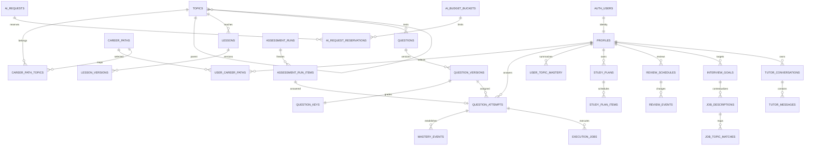

# Proposed relational database schema

Status: design only, 2026-10-21. These are complete logical table definitions for the three-phase plan, not installed migrations or a tested database. Create tables incrementally by phase; do not provision all future tables during the MVP. Use PostgreSQL on Supabase, with Supabase-managed `auth.users` as the identity source.

## Definition conventions

- Unless explicitly nullable (`?`), every field is `NOT NULL`. `uuid` primary-key `id` fields default to `gen_random_uuid()`. `created_at timestamptz` defaults to `now()` wherever listed. `updated_at timestamptz` defaults to `now()` and is maintained by a trusted update trigger. Defaults other than these are stated explicitly; callers supply other required values.
- `PK`, `FK`, `UQ`, and `CHECK` denote primary keys, foreign keys, unique constraints, and checks. All FKs name their target below. Indexes backing PK/UQ constraints are implicit. Additional indexes are listed separately. Do not add duplicate PK indexes.
- **Owned table convention:** every `user_id uuid` is an FK to `public.profiles(id) ON DELETE CASCADE`. Owner identity is set by a verified server context, never trusted from the request body. Where rows refer to another owned table, the additional composite FK `(user_id, parent_id) -> parent(user_id, id)` enforces same-user ownership. Each such parent has `UQ(user_id, id)` even though `id` is globally unique.
- Unless specified otherwise, non-owner FKs use `ON DELETE RESTRICT`, preserving historical references. Join rows use the cascade actions stated below. Versioned content is retired, not hard-deleted; deleting draft-only content needs a dedicated trusted maintenance transaction.
- All bounded `text` values have a database length check corresponding to the bounds stated below. API schemas enforce tighter feature-specific request limits. Slugs are lowercase, unique within their stated scope, and match `^[a-z0-9]+(-[a-z0-9]+)*$`. All counters are nonnegative; all scores in `[0,1]`; positive durations/ordinals as specified. JSON fields require the JSON type stated below and a versioned runtime schema. JSON is for content/response payloads, not substitutes for relational ownership or foreign keys.
- Persist instants as `timestamptz` (UTC); local interview/scheduled dates use `date` plus a validated IANA timezone. Use `numeric`, not floating point, for costs. Use text plus named `CHECK` constraints for enumerated states so migrations can extend them deliberately.
- `public` is the API-exposed schema with RLS and explicit grants. `private` is not exposed through the Supabase Data API; its objects have no `anon`/`authenticated` table privileges. Sensitive RPCs are also restricted. Content is readable only when published, not merely because its parent row exists.

## Relationships

The diagram summarizes major relationships. The definitions below are authoritative, including additional ownership and version FKs.

## Phase 1: identity and curriculum

### 1. `public.profiles`

Fields: `id uuid PK FK -> auth.users(id) ON DELETE CASCADE` (no random default); `display_name text?` (1-80 chars when present); `timezone text` (1-100, default `UTC`); `onboarding_completed_at timestamptz?`; `created_at`; `updated_at`.

One profile per auth identity. Email/password/verification remain in `auth`, with no duplicate password or email columns. Validate timezone against the installed timezone catalog in a trusted function. An idempotent signup trigger creates a minimal profile; repair missing profiles safely on login. Learners may update only display name and timezone through restricted column grants/use cases; they cannot set identity or trusted onboarding completion directly.

### 2. `public.career_paths`

Fields: `id uuid PK`; `slug text UQ`; `name text` (1-120); `description text` (1-2000); `is_active boolean DEFAULT true`; `sort_order integer DEFAULT 0`; `created_at`; `updated_at`.

Seed the six names in the PRD. No user-selected string enum is hardcoded as the curriculum model. Index active catalog ordering `(is_active, sort_order)`.

### 3. `public.topics`

Fields: `id uuid PK`; `parent_topic_id uuid? FK -> topics(id)`; `slug text UQ`; `title text` (1-160); `description text` (1-4000); `sort_order integer DEFAULT 0`; `estimated_minutes integer CHECK > 0`; `status text CHECK IN ('draft','published','retired') DEFAULT 'draft'`; `created_at`; `updated_at`.

Topics and subtopics share a self-referencing tree. `CHECK(parent_topic_id IS DISTINCT FROM id)`. A trusted constraint trigger rejects multi-node parent cycles. Index `(parent_topic_id, sort_order)` and `(status, sort_order)`. A published child requires published ancestors; enforce during publication. Parent summaries must not double-count child evidence.

### 4. `public.topic_prerequisites`

Fields: `topic_id uuid FK -> topics(id) ON DELETE CASCADE`; `prerequisite_topic_id uuid FK -> topics(id)`; `created_at`. `PK(topic_id, prerequisite_topic_id)`; `CHECK(topic_id <> prerequisite_topic_id)`.

Trusted trigger rejects cycles in the prerequisite graph, including across different branches of the topic tree. Index `(prerequisite_topic_id, topic_id)` for reverse traversal. Publication verifies prerequisites are available. Tree ancestry and prerequisite edges serve different purposes.

### 5. `public.career_path_topics`

Fields: `career_path_id uuid FK -> career_paths(id) ON DELETE CASCADE`; `topic_id uuid FK -> topics(id)`; `relevance numeric(4,3) CHECK BETWEEN 0 AND 1`; `sort_order integer DEFAULT 0`; `is_core boolean DEFAULT true`. `PK(career_path_id, topic_id)`.

Index `(topic_id, career_path_id)` and `(career_path_id, sort_order)`. Shared topics are stored once. Union selected paths on read, with deterministic deduplication.

### 6. `public.user_career_paths`

Fields: `user_id uuid`; `career_path_id uuid FK -> career_paths(id)`; `is_primary boolean DEFAULT false`; `created_at`. `PK(user_id, career_path_id)`.

Partial unique index `(user_id) WHERE is_primary` permits at most one primary path. A deferred constraint trigger/trusted onboarding transaction requires at least one selection and exactly one primary for an onboarded user; allow zero during signup and deletion. Index `(career_path_id, user_id)` for its FK. Changing the primary is one transaction, not two client requests.

### 7. `public.lessons`

Fields: `id uuid PK`; `topic_id uuid FK -> topics(id)`; `slug text`; `title text` (1-160); `sort_order integer DEFAULT 0`; `created_at`; `updated_at`. `UQ(topic_id, slug)`.

Index `(topic_id, sort_order)`. Logical lesson identity is stable; content lives in versions.

### 8. `public.lesson_versions`

Fields: `id uuid PK`; `lesson_id uuid FK -> lessons(id)`; `version integer CHECK > 0`; `body jsonb` (object: objective, sections, worked examples, embedded question references, takeaways); `estimated_minutes integer CHECK > 0`; `status text CHECK IN ('draft','published','retired') DEFAULT 'draft'`; `source_references jsonb DEFAULT '[]'` (array); `content_hash text` (64-char SHA-256); `published_at timestamptz?`; `created_at`.

`UQ(lesson_id, version)`; `UQ(lesson_id, id)` for progress references. Partial unique index `(lesson_id) WHERE status='published'` permits one current published version. Historical retired versions are available only to authorized history use cases. `CHECK(status <> 'published' OR published_at IS NOT NULL)`. Publication requires an approved review, valid content schema, published topic, and valid referenced published question versions. JSON references to embedded checks must be validated at import/publication; questions still use the standard attempt workflow. After publication, content/hash/version are immutable. To edit, create a new draft and atomically retire/publish.

### 9. `public.lesson_progress`

Fields: `user_id uuid`; `lesson_id uuid FK -> lessons(id)`; `lesson_version_id uuid`; `resume_section integer DEFAULT 0 CHECK >= 0`; `status text CHECK IN ('started','completed') DEFAULT 'started'`; `completed_at timestamptz?`; `updated_at`. `PK(user_id, lesson_id)`; `FK(lesson_id, lesson_version_id) -> lesson_versions(lesson_id, id)`.

`CHECK((status='completed') = (completed_at IS NOT NULL))`. Validate resume bounds against the referenced content version. Index `(user_id, updated_at DESC)` and `(lesson_id, lesson_version_id)`. Explicitly activity data; no mastery side effects. Keep the studied version when content changes and offer to restart the new version.

### 10. `public.questions`

Fields: `id uuid PK`; `topic_id uuid FK -> topics(id)`; `slug text UQ`; `created_at`; `updated_at`. Index `(topic_id)`.

A question tests one primary topic initially. Keep logical identity to avoid treating revisions as independent daily evidence. Freeze its topic attribution once any version is published so historical mastery cannot move silently. Multi-topic scoring requires future explicit rubric weights; do not infer it from arbitrary tags.

### 11. `public.question_versions`

Fields: `id uuid PK`; `question_id uuid FK -> questions(id)`; `version integer CHECK > 0`; `type text CHECK IN ('single_choice','python','sql','short_answer')`; `difficulty smallint CHECK BETWEEN 1 AND 3`; `visibility text CHECK IN ('practice','assessment_only') DEFAULT 'practice'`; `prompt text` (1-20000); `options jsonb?` (array of distinct `{id,text}` objects); `public_context jsonb DEFAULT '{}'` (object: visible examples, schema description, starter code); `status text CHECK IN ('draft','published','retired') DEFAULT 'draft'`; `origin text CHECK IN ('human','ai_assisted','imported')`; `generation_request_id uuid?`; `source_references jsonb DEFAULT '[]'` (array); `content_hash text` (64-char SHA-256 of public content only); `published_at timestamptz?`; `created_at`.

`UQ(question_id, version)`; `UQ(question_id, id)`; partial unique index `(question_id) WHERE status='published'`; index `(status, visibility, type, difficulty)` and `(generation_request_id)` when added. `generation_request_id -> private.ai_requests(id) ON DELETE SET NULL` added after that table exists. `CHECK((type='single_choice') = (options IS NOT NULL))`; `CHECK(status <> 'published' OR published_at IS NOT NULL)`. Single-choice options require at least two distinct IDs/texts and exactly one matching private correct-option ID, enforced in publication validation. Phase 1 publication rejects every type except single_choice, rejects hard difficulty, and requires practice visibility. Assessment-only prompts bypass ordinary catalog reads only through an authorized assigned-run DTO; private solutions remain protected until the run's release policy allows them. No correct answers, hints, hidden tests, or protected explanations in this row.

### 12. `private.question_keys`

Fields: `question_version_id uuid PK FK -> question_versions(id)`; `grading_spec jsonb` (object with versioned deterministic answer/rubric contract); `explanation text` (1-20000); `hints jsonb DEFAULT '[]'` (array); `misconception_feedback jsonb DEFAULT '{}'` (object keyed by option ID or error category); `grader_version text` (1-100); `created_at`.

One private key per publishable version. For single-choice, `grading_spec` contains the correct option ID. Short-answer rubrics are qualitative unless a reviewed deterministic validator exists. Executable types reference private exercise configuration below. Keys become immutable with their published version. Only grading/disclosure use cases and content-maintenance roles can read them. Hints/solutions are disclosed as bounded DTOs after policy checks.

### 13. `private.content_reviews`

Fields: `id uuid PK`; `lesson_version_id uuid? FK -> lesson_versions(id)`; `question_version_id uuid? FK -> question_versions(id)`; `review_bundle_hash text` (64); `reviewer_user_id uuid? FK -> auth.users(id) ON DELETE SET NULL`; `reviewer_label text` (1-120; non-sensitive stable label); `verdict text CHECK IN ('approved','rejected','needs_changes')`; `checklist jsonb` (object); `notes text?` (at most 8000); `created_at`.

`CHECK(num_nonnulls(lesson_version_id, question_version_id)=1)`. Index `(lesson_version_id, created_at DESC)` and `(question_version_id, created_at DESC)`. The private review bundle hash covers the public content plus private key, hints, explanations, and exercise configuration/tests where applicable. Review must apply to that current bundle; changing a key after review invalidates approval too. Keep this hash private rather than offering a browser-visible digest of low-entropy answers. Human/developer approval is separate from automated AI verification. Preserve review history; no learner access or self-assigned reviewer privileges.

## Phase 1: activity, grading, and goals

### 14. `public.study_sessions`

Fields: `id uuid PK`; `user_id uuid`; `kind text CHECK IN ('lesson','practice','tutor','review','assessment')`; `topic_id uuid? FK -> topics(id)`; `started_at timestamptz DEFAULT now()`; `ended_at timestamptz?`; `active_seconds integer DEFAULT 0 CHECK >= 0`; `created_at`. `UQ(user_id, id)`; `CHECK(ended_at IS NULL OR ended_at >= started_at)`.

Indexes `(user_id, started_at DESC)`, `(topic_id)`. Server bounds heartbeat increments and ignores time when inactive; time is approximate engagement, never learning evidence. Phase 1 allows only lesson/practice/tutor kinds. Sessions can be abandoned without fabricating a completed duration.

### 15. `public.question_attempts`

Fields: `id uuid PK`; `user_id uuid`; `question_id uuid`; `question_version_id uuid`; `study_session_id uuid?`; `assessment_item_id uuid?` (Phase 2 FK); `assignment_key uuid`; `submission_key uuid?`; `submission_hash text?` (64); `response jsonb?` (object); `state text CHECK IN ('assigned','submitted','grading','graded','failed','abandoned') DEFAULT 'assigned'`; `score numeric(6,5)? CHECK BETWEEN 0 AND 1`; `grading_method text? CHECK IN ('answer_key','test_cases','deterministic_validator','ai_rubric')`; `grader_version text?` (1-100); `feedback jsonb?` (object, stored protected until authorized release); `hint_count integer DEFAULT 0 CHECK >= 0`; `solution_viewed_at timestamptz?`; `tutor_assisted_at timestamptz?`; `evidence_eligible boolean DEFAULT false`; `evidence_day date?`; `submitted_at timestamptz?`; `graded_at timestamptz?`; `revision integer DEFAULT 0 CHECK >= 0`; `created_at`.

`UQ(user_id, id)`; `UQ(user_id, assignment_key)`; partial UQ `(user_id, submission_key) WHERE submission_key IS NOT NULL`; `FK(question_id, question_version_id) -> question_versions(question_id, id)`; composite owner/session FK as defined above. Phase 2 composite owner/assessment-item FK also applies. A partial UQ `(assessment_item_id) WHERE assessment_item_id IS NOT NULL` gives each assessment item one attempt with repeated draft autosaves, not repeated independent answers.

`CHECK((state='graded') = (graded_at IS NOT NULL))`; graded requires score, grader version, and method. Eligible requires graded state, a deterministic method (not ai_rubric), no hint/solution/tutor exposure before answer, and non-null evidence_day. `evidence_day` is server-derived from `submitted_at AT TIME ZONE 'UTC'`, with a trigger rejecting mismatch. Partial UQ `(user_id, question_id, evidence_day) WHERE evidence_eligible` enforces the daily logical-question cap. The trusted transaction also checks every same-day attempt for that user/logical question: only the first finalized answer can qualify, and known assistance on another attempt disqualifies it. Reopening an attempt cannot erase exposure. Hint/solution writes take the same user/topic lock as grading. Record pre-submission assistance permanently; showing feedback after grading must not retroactively invalidate an independent answer.

Indexes `(user_id, created_at DESC, id)`, `(user_id, state)`, `(question_id, question_version_id)`, `(user_id, study_session_id)`, and `(user_id, assessment_item_id)` when introduced. Index `(user_id, graded_at DESC) WHERE evidence_eligible` supports mastery queries. Clients cannot INSERT/UPDATE this table directly: otherwise they could forge evidence or unlock protected feedback. All reads use safe owner-scoped projections/RPCs; block raw reads for in-progress assessments so stored feedback cannot leak. Finalized responses are immutable except through a trusted correction workflow that increments revision and appends an event.

### 16. `public.user_topic_mastery`

Fields: `user_id uuid`; `topic_id uuid FK -> topics(id)`; `algorithm_version text` (1-100); `alpha numeric(12,5) CHECK > 0`; `beta numeric(12,5) CHECK > 0`; `estimate numeric(6,5) CHECK BETWEEN 0 AND 1`; `eligible_attempt_count integer CHECK BETWEEN 0 AND 30`; `distinct_question_count integer CHECK BETWEEN 0 AND 30`; `distinct_evidence_days integer CHECK BETWEEN 0 AND 30`; `last_evidence_at timestamptz?`; `computed_at timestamptz DEFAULT now()`. `PK(user_id, topic_id)`; index `(topic_id, user_id)`.

Server-owned rebuildable projection. Validate estimate against `alpha/(alpha+beta)` within rounding tolerance; counts agree with the selected evidence set. No row/no evidence means "Not assessed", not 50%. Use the exact eligibility, weighting, window, and label thresholds in [PRD.md](PRD.md). Read only for learners; no direct writes even to their own row.

### 17. `public.mastery_events`

Fields: `id uuid PK`; `user_id uuid`; `topic_id uuid FK -> topics(id)`; `attempt_id uuid`; `attempt_revision integer CHECK >= 0`; `event_type text CHECK IN ('graded','corrected','excluded')`; `score numeric(6,5)? CHECK BETWEEN 0 AND 1`; `weight numeric(5,2) CHECK >= 0`; `eligible boolean`; `algorithm_version text` (1-100); `reason_code text` (1-100); `created_at`.

Composite owner/attempt FK. `UQ(attempt_id, attempt_revision, algorithm_version)` makes each outcome revision's evidence event idempotent. Index `(user_id, topic_id, created_at DESC)` and `(user_id, attempt_id)`. Immutable, server-written evidence audit, including exclusion reasons. Projection recomputation uses the eligible attempt window, not a lifetime sum of events. Corrections can replace/exclude previous evidence without pretending the old event never occurred.

### 18. `public.interview_goals`

Fields: `id uuid PK`; `user_id uuid`; `title text` (1-160); `career_path_id uuid? FK -> career_paths(id)`; `interview_date date?`; `timezone text` (1-100); `status text CHECK IN ('active','completed','archived') DEFAULT 'active'`; `daily_minutes integer DEFAULT 30 CHECK BETWEEN 5 AND 240`; `available_weekdays smallint[] DEFAULT '{1,2,3,4,5}'`; `created_at`; `updated_at`.

`UQ(user_id, id)`; partial UQ `(user_id) WHERE status='active'`. Index `(career_path_id)` and `(user_id, status, interview_date)`. Phase 1 uses title/date/timezone only; capacity fields power Phase 2. Validate unique ISO weekdays in 1..7; an empty array is allowed and yields an explicit infeasible-plan state. Past dates remain valid historical data. Changing profile timezone does not silently change the goal's date interpretation.

## Phase 1: tutoring and cost control

### 19. `public.tutor_conversations`

Fields: `id uuid PK`; `user_id uuid`; `topic_id uuid? FK -> topics(id)`; `lesson_version_id uuid? FK -> lesson_versions(id)`; `practice_attempt_id uuid?`; `assessment_run_id uuid?` (Phase 3 same-owner FK); `kind text CHECK IN ('tutor','interview_simulation') DEFAULT 'tutor'`; `title text` (1-160); `explanation_level text CHECK IN ('beginner','intermediate','advanced') DEFAULT 'beginner'`; `created_at`; `updated_at`.

`UQ(user_id, id)`; composite owner/practice-attempt FK. Index `(user_id, updated_at DESC, id)`, `(topic_id)`, `(lesson_version_id)`, `(user_id, practice_attempt_id)`, and owner/assessment FK when added. Phase 1 supports only tutor kind. A trusted validation ensures lesson/attempt context matches the selected topic where present and that the learner may access that version. Attempt-bound help marks assistance before calling the provider; protected assessment items cannot open an unrestricted tutor context. Learners may read/delete their own conversations through validated paths; generation ownership and all message writes stay server-controlled.

### 20. `public.tutor_messages`

Fields: `id uuid PK`; `user_id uuid`; `conversation_id uuid`; `sequence integer CHECK > 0`; `role text CHECK IN ('user','assistant')`; `content text` (at most 32000); `status text CHECK IN ('pending','complete','interrupted','refused','failed')`; `client_turn_key uuid?`; `reply_to_message_id uuid?`; `ai_request_id uuid?`; `source_references jsonb DEFAULT '[]'` (array of authorized lesson/topic refs); `created_at`.

Composite owner/conversation FK `ON DELETE CASCADE`; `UQ(user_id, id)`; `UQ(conversation_id, id)`; `UQ(conversation_id, sequence)`; partial UQ `(conversation_id, client_turn_key) WHERE client_turn_key IS NOT NULL`; partial UQ `(ai_request_id) WHERE ai_request_id IS NOT NULL`. Self composite FK `(conversation_id, reply_to_message_id) -> tutor_messages(conversation_id, id)` ensures replies remain in conversation; `ON DELETE CASCADE`. `ai_request_id -> private.ai_requests(id) ON DELETE SET NULL` once table exists. Validate same owner in trusted insert. Index `(user_id, conversation_id, sequence)`, `(conversation_id, reply_to_message_id)`.

User turns and final assistant text are persisted server-side. Empty assistant content is allowed while pending or failed; a complete turn must have content. Internal system/developer prompts are not stored in this exposed table. Interrupted responses are labeled and never passed off as complete. Message size in storage allows accumulated assistant text; the Phase 1 request limit for a new user message is 2,000 characters.

### 21. `private.ai_requests`

Fields: `id uuid PK`; `user_id uuid`; `capability text CHECK IN ('tutor','question_draft','job_analysis','plan_explanation','interview_feedback')`; `idempotency_key uuid`; `input_hash text` (64); `model text` (1-160); `prompt_version text` (1-100); `status text CHECK IN ('reserved','running','succeeded','failed','cancelled','usage_unknown')`; `provider_request_ids jsonb DEFAULT '[]'` (array, capped at the configured attempt limit); `provider_attempt_count smallint DEFAULT 0 CHECK BETWEEN 0 AND 2`; `input_tokens integer? CHECK >= 0`; `output_tokens integer? CHECK >= 0`; `reserved_cost_usd numeric(14,8) CHECK >= 0`; `actual_cost_usd numeric(14,8)? CHECK >= 0`; `rate_snapshot jsonb` (object: prices, billing categories, effective version); `error_code text?` (at most 100); `lease_expires_at timestamptz?`; `started_at timestamptz?`; `finished_at timestamptz?`; `created_at`.

`UQ(user_id, id)`; `UQ(user_id, capability, idempotency_key)`. Index `(user_id, created_at DESC)`, `(status, lease_expires_at)`, `(capability, created_at)`. Counters/costs include any bounded provider retry; the reservation must cover the maximum allowed attempts. This ledger contains metadata, not full prompts. Authenticated users receive only safe quota summaries. Unknown usage retains reservation until reconciled. Owned cascading deletion is coordinated with budget reconciliation so deleting an account cannot release incurred spend or corrupt shared global totals.

### 22. `private.ai_budget_buckets`

Fields: `id uuid PK`; `scope text CHECK IN ('user_daily','global_monthly')`; `user_id uuid? FK -> profiles(id) ON DELETE CASCADE`; `period_start timestamptz`; `period_end timestamptz`; `currency text DEFAULT 'USD' CHECK = 'USD'`; `limit_usd numeric(14,8) CHECK > 0`; `reserved_usd numeric(14,8) DEFAULT 0 CHECK >= 0`; `spent_usd numeric(14,8) DEFAULT 0 CHECK >= 0`; `reserved_calls integer DEFAULT 0 CHECK >= 0`; `completed_calls integer DEFAULT 0 CHECK >= 0`; `call_limit integer? CHECK > 0`; `updated_at`.

`CHECK((scope='user_daily') = (user_id IS NOT NULL))`; `CHECK(period_end > period_start)`. Partial UQ `(user_id, period_start) WHERE scope='user_daily'`; partial UQ `(scope, period_start) WHERE scope='global_monthly'`. Periods are UTC-aligned days/months, verified by trusted creation. Shared global bucket has no user and survives account deletion. Lock buckets in stable order for reservation and reconciliation. Do not constrain `spent+reserved <= limit` as a permanent database invariant: unexpected provider overage must still be recorded truthfully. The admission transaction rejects new reservations when they would exceed the limit. User concurrency limits additionally query running/reserved requests under a per-user lock.

### 23. `private.ai_request_reservations`

Fields: `request_id uuid FK -> private.ai_requests(id) ON DELETE CASCADE`; `bucket_id uuid FK -> private.ai_budget_buckets(id)`; `reserved_usd numeric(14,8) CHECK >= 0`; `settled_usd numeric(14,8)? CHECK >= 0`; `settled_at timestamptz?`; `created_at`. `PK(request_id, bucket_id)`; index `(bucket_id, request_id)`.

One row per applicable bucket, normally daily user and monthly global. Application transactions ensure both are reserved/reconciled exactly once. Bucket totals are durable accounting snapshots, not cascading sums of the remaining request rows. Purge/deletion reconciles outstanding reservations and preserves global spend before removing links. Concurrent replay must not charge or release twice.

## Phase 2: personalization and review

### 24. `public.job_descriptions`

Fields: `id uuid PK`; `user_id uuid`; `interview_goal_id uuid?`; `title text?` (at most 160); `raw_text text` (1-20000); `content_hash text` (64); `ai_processing_consented_at timestamptz`; `analysis_status text CHECK IN ('pending','running','complete','failed') DEFAULT 'pending'`; `analysis_request_id uuid? FK -> private.ai_requests(id) ON DELETE SET NULL`; `analyzed_at timestamptz?`; `expires_at timestamptz?`; `created_at`; `updated_at`.

`UQ(user_id, id)`; composite owner/goal FK. Index `(user_id, created_at DESC)`, `(user_id, interview_goal_id)`, `(expires_at) WHERE expires_at IS NOT NULL`, `(analysis_request_id)`. Server requires consent before the AI call, and uses current hash to reject stale analysis. Do not fetch arbitrary URLs. Deletion removes raw text and matches; plans retain only non-sensitive topic/relevance snapshots. Expiry default is application-calculated 90 days; a user retention choice may clear it.

### 25. `public.job_topic_matches`

Fields: `user_id uuid`; `job_description_id uuid`; `topic_id uuid FK -> topics(id)`; `analysis_request_id uuid? FK -> private.ai_requests(id) ON DELETE SET NULL`; `relevance numeric(4,3) CHECK BETWEEN 0 AND 1`; `confidence numeric(4,3) CHECK BETWEEN 0 AND 1`; `evidence_excerpt text` (1-1000); `user_decision text CHECK IN ('unreviewed','accepted','rejected') DEFAULT 'unreviewed'`; `created_at`; `updated_at`. `PK(job_description_id, topic_id)`; composite owner/job FK `ON DELETE CASCADE`.

Indexes `(user_id, job_description_id)`, `(topic_id)`, `(analysis_request_id)`. Validate excerpt occurs in the source; confidence is a model's uncalibrated self-estimate, not a factual certainty. Only confirmed accepted mappings influence job relevance. Learners can change the decision, not forge AI provenance or another owner's matches.

### 26. `public.study_plans`

Fields: `id uuid PK`; `user_id uuid`; `interview_goal_id uuid`; `version integer CHECK > 0`; `status text CHECK IN ('active','superseded','completed') DEFAULT 'active'`; `algorithm_version text` (1-100); `input_snapshot jsonb` (object: capacity, goal date/timezone, topic weights/evidence, no raw job text); `input_hash text` (64); `idempotency_key uuid`; `unallocated_minutes integer DEFAULT 0 CHECK >= 0`; `created_at`.

`UQ(user_id, id)`; `UQ(interview_goal_id, version)`; `UQ(user_id, idempotency_key)`; composite owner/goal FK. Partial UQ `(interview_goal_id) WHERE status='active'`; index `(user_id, created_at DESC)`. Rebuild locks the goal, checks idempotency/input hash, versions the plan, and preserves completed work as described in the architecture. No LLM decides final plan feasibility.

### 27. `public.study_plan_items`

Fields: `id uuid PK`; `user_id uuid`; `study_plan_id uuid`; `topic_id uuid FK -> topics(id)`; `lesson_version_id uuid? FK -> lesson_versions(id)`; `review_schedule_id uuid?` (same-owner FK once created); `kind text CHECK IN ('lesson','practice','review','assessment')`; `scheduled_date date`; `timezone text` (1-100); `position integer CHECK >= 0`; `estimated_minutes integer CHECK > 0`; `priority numeric(6,5) CHECK BETWEEN 0 AND 1`; `reason_code text` (1-100); `status text CHECK IN ('pending','in_progress','completed','skipped') DEFAULT 'pending'`; `completed_at timestamptz?`; `previous_item_id uuid?`; `created_at`; `updated_at`.

`UQ(user_id, id)`; `UQ(study_plan_id, scheduled_date, position)`; composite owner/plan FK `ON DELETE CASCADE`; composite owner/previous-item FK. Index `(user_id, scheduled_date, status)`, `(topic_id)`, `(lesson_version_id)`, and `(user_id, review_schedule_id)`. Validate kind-specific references: lesson requires lesson_version, review requires review_schedule; other kinds leave both null. Lesson version must belong to the topic. A completion timestamp exists iff completed. Plan-generation transaction enforces per-local-date minutes <= capacity, prerequisite ordering, and that completed work is carried forward at most once.

### 28. `public.review_schedules`

Fields: `id uuid PK`; `user_id uuid`; `topic_id uuid FK -> topics(id)`; `question_id uuid FK -> questions(id)`; `algorithm_version text` (1-100); `interval_step smallint DEFAULT 0 CHECK BETWEEN 0 AND 4`; `due_local_date date`; `timezone text` (1-100); `due_at timestamptz`; `last_attempt_id uuid?`; `status text CHECK IN ('active','paused','retired') DEFAULT 'active'`; `revision integer DEFAULT 0 CHECK >= 0`; `created_at`; `updated_at`.

`UQ(user_id, id)`; `UQ(user_id, question_id)`; composite owner/last-attempt FK. Index `(user_id, status, due_at)`, `(topic_id)`, `(question_id)`, `(user_id, last_attempt_id)`. Trusted validation ensures topic matches question and due_at corresponds to local date/timezone under the algorithm's documented local review time (default 09:00, shifted to a valid instant for timezone transitions). A review assignment resolves the current published question version; retired content produces a replacement/pause, never a dangling key. Question recurrence is not a new logical question for mastery deduplication.

### 29. `public.review_events`

Fields: `id uuid PK`; `user_id uuid`; `review_schedule_id uuid`; `attempt_id uuid`; `schedule_revision integer CHECK > 0`; `outcome text CHECK IN ('independent_correct','incorrect','assisted')`; `previous_due_at timestamptz`; `new_due_at timestamptz`; `previous_step smallint CHECK BETWEEN 0 AND 4`; `new_step smallint CHECK BETWEEN 0 AND 4`; `algorithm_version text` (1-100); `created_at`.

Composite owner/schedule FK `ON DELETE CASCADE`; composite owner/attempt FK. `UQ(attempt_id)`; `UQ(review_schedule_id, schedule_revision)`; index `(user_id, created_at DESC)`, `(user_id, attempt_id)`. Grade, mastery, schedule revision, and review event commit together. Reviewed item must belong to the schedule question, checked inside the transaction. Replay returns the prior transition.

## Phase 2 diagnostic and Phase 3 assessment/simulation

### 30. `public.assessment_templates`

Fields: `id uuid PK`; `slug text`; `version integer CHECK > 0`; `title text` (1-160); `kind text CHECK IN ('diagnostic','mock','interview_simulation')`; `career_path_id uuid? FK -> career_paths(id)`; `duration_seconds integer? CHECK > 0`; `blueprint jsonb` (object: topic coverage, scoring policy, simulation rubric); `status text CHECK IN ('draft','published','retired') DEFAULT 'draft'`; `created_at`.

`UQ(slug, version)`; partial UQ `(slug) WHERE status='published'`; index `(career_path_id, kind, status)`. Mock requires duration. Blueprint is immutable once published. AI simulations have a reviewed rubric but do not claim deterministic numeric mastery. Template item selection stays server-controlled; raw blueprint does not expose fixed hidden questions during a protected mock.

### 31. `private.assessment_template_items`

Fields: `id uuid PK`; `template_id uuid FK -> assessment_templates(id)`; `question_version_id uuid FK -> question_versions(id)`; `position integer CHECK >= 0`; `points numeric(8,2) CHECK > 0`. `UQ(template_id, position)`; `UQ(template_id, question_version_id)`; index `(question_version_id)`.

Private fixed item list for initial diagnostics/mocks; avoid building a generalized adaptive testing engine. Publication requires appropriate reviewed versions and blueprint coverage. Simulations may instead use blueprint-driven turns with no fixed question rows.

### 32. `public.assessment_runs`

Fields: `id uuid PK`; `user_id uuid`; `template_id uuid FK -> assessment_templates(id)`; `interview_goal_id uuid?`; `idempotency_key uuid`; `kind text CHECK IN ('diagnostic','mock','interview_simulation')`; `state text CHECK IN ('created','active','submitted','grading','completed','expired','abandoned') DEFAULT 'created'`; `started_at timestamptz?`; `deadline_at timestamptz?`; `submitted_at timestamptz?`; `completed_at timestamptz?`; `total_points numeric(10,2) CHECK >= 0`; `earned_points numeric(10,2)? CHECK >= 0`; `feedback jsonb?` (object); `created_at`.

`UQ(user_id, id)`; `UQ(user_id, idempotency_key)`; composite owner/goal FK. Index `(user_id, created_at DESC)`, `(template_id)`, `(user_id, interview_goal_id)`, `(deadline_at) WHERE state='active'`. `CHECK(earned_points IS NULL OR earned_points <= total_points)`; `CHECK(deadline_at IS NULL OR (started_at IS NOT NULL AND deadline_at > started_at))`. Trusted start freezes kind/template, total, assignment, deadline, and grading policy. Final writes check database server time, not a browser clock. Simulation feedback is explicitly qualitative; earned_points may remain null.

### 33. `public.assessment_run_items`

Fields: `id uuid PK`; `user_id uuid`; `assessment_run_id uuid`; `question_id uuid`; `question_version_id uuid`; `position integer CHECK >= 0`; `points numeric(8,2) CHECK > 0`; `created_at`.

`UQ(user_id, id)`; `UQ(assessment_run_id, position)`; `UQ(assessment_run_id, question_id)`; composite owner/run FK `ON DELETE CASCADE`; `FK(question_id, question_version_id) -> question_versions(question_id, id)`. Index `(user_id, assessment_run_id)` and `(question_id, question_version_id)`. Assignment is immutable. Add same-owner FK from question_attempts.assessment_item_id and tutor_conversations.assessment_run_id after these exist. Answering a run item uses the assigned version, even after curriculum updates. Hidden scores/feedback are available only through gated read DTOs after permitted release. The assignment and attempt paths check that both versions agree.

## Phase 3: isolated execution

### 34. `private.exercise_configs`

Fields: `question_version_id uuid PK FK -> question_versions(id)`; `language text CHECK IN ('python','postgresql')`; `runtime_image text` (1-240, pinned immutable image/runtime identifier); `entrypoint text?` (at most 160); `dataset_fixture_ref text?` (at most 1000, private fixture artifact reference); `cpu_ms integer CHECK > 0`; `wall_ms integer CHECK > 0`; `memory_mib integer CHECK > 0`; `output_bytes integer CHECK > 0`; `network_policy text DEFAULT 'deny' CHECK = 'deny'`; `comparison_spec jsonb` (object); `harness_version text` (1-100); `created_at`.

Trusted publication validates language/type agreement, resource ceilings, fixture accessibility, and verified reference solutions. SQL uses a disposable separate database, never production Supabase. Configuration cannot grant arbitrary network or runtime privileges through learner inputs. No signed fixture URLs in browser-visible content.

### 35. `private.exercise_test_cases`

Fields: `id uuid PK`; `question_version_id uuid FK -> private.exercise_configs(question_version_id)`; `position integer CHECK >= 0`; `visibility text CHECK IN ('public','hidden')`; `input_payload jsonb` (object); `expected_payload jsonb` (object); `weight numeric(8,2) CHECK > 0`; `created_at`. `UQ(question_version_id, position)`.

Private trusted harness owns these rows. Only explicitly public examples are copied into a version's public_context at publication. Hidden fixtures/expected outputs are not delivered to the learner process as readable files. Test results sent back to the application use stable test IDs and bounded outcomes; learner stdout cannot declare pass/fail. Artifact blobs, if needed, live in a private bucket with the same trusted-only access policy and version/hash verification.

### 36. `public.execution_jobs`

Fields: `id uuid PK`; `user_id uuid`; `attempt_id uuid`; `question_version_id uuid FK -> private.exercise_configs(question_version_id)`; `idempotency_key uuid`; `input_hash text` (64); `source_code text` (1-32000); `state text CHECK IN ('queued','dispatching','running','succeeded','failed','timed_out','cancelled') DEFAULT 'queued'`; `provider text` (1-100); `provider_job_id text?` (at most 240); `dispatch_attempts integer DEFAULT 0 CHECK >= 0`; `dispatch_lease_until timestamptz?`; `next_dispatch_at timestamptz DEFAULT now()`; `result jsonb?` (object, safe aggregate only); `error_code text?` (at most 100); `cpu_ms integer? CHECK >= 0`; `wall_ms integer? CHECK >= 0`; `memory_kib integer? CHECK >= 0`; `expires_at timestamptz`; `started_at timestamptz?`; `finished_at timestamptz?`; `created_at`.

`UQ(user_id, id)`; `UQ(user_id, idempotency_key)`; partial UQ `(provider, provider_job_id) WHERE provider_job_id IS NOT NULL`; composite owner/attempt FK. Index `(state, next_dispatch_at) WHERE state IN ('queued','dispatching')`, `(user_id, created_at DESC)`, `(user_id, attempt_id)`, `(question_version_id)`, and `(expires_at)`. Only one nonterminal job per attempt: partial UQ `(attempt_id) WHERE state IN ('queued','dispatching','running')`.

Question version must match the owned attempt; use a trusted insert validation/trigger. This table is both the job ledger and durable dispatch outbox, avoiding an extra queue for the first implementation. Dispatch requires a reliable managed trigger/scheduler; serverless fire-and-forget is not sufficient. State transitions are server-owned and monotonic. Failed/timed_out are infrastructure/execution status and do not automatically become incorrect mastery evidence. Only a trusted terminal result finalizes the attempt, once. Owner reads return a safe projection excluding source where not requested, provider internals, private errors, and hidden cases. Execution source and result expire after 30 days by default; preserve non-sensitive attempt grade/history.

### 37. `private.execution_callback_events`

Fields: `id uuid PK`; `execution_job_id uuid FK -> execution_jobs(id) ON DELETE CASCADE`; `provider text` (1-100); `provider_event_id text` (1-240); `payload_hash text` (64); `event_type text` (1-100); `received_at timestamptz DEFAULT now()`; `processed_at timestamptz?`; `outcome text CHECK IN ('accepted','duplicate','rejected','pending')`; `error_code text?` (at most 100).

`UQ(provider, provider_event_id)`; index `(execution_job_id, received_at)`. Signature/timestamp verification occurs before acceptance. Reject a repeated event ID with a changed hash. Do not store arbitrary full payloads or hidden output in logs. Callback transaction locks the job, validates provider-job/version linkage, updates state, and dispatches trusted grading exactly once; late terminal callbacks cannot resurrect cancelled/deleted work.

## Access, grants, and integrity matrix

Supabase RLS is mandatory for every public table, even those intended to be reached only through the app. Default deny: enabling RLS does not replace revoking inappropriate privileges. Policies must be tested with actual `anon` and `authenticated` roles. Supabase privileged secret/service roles can bypass RLS; see [official RLS guidance](https://supabase.com/docs/guides/database/postgres/row-level-security). Never expose those keys to the browser.

| Group | Learner read | Learner direct write | Trusted writes |
| --- | --- | --- | --- |
| Profiles | Own row | Display name/timezone only, column-restricted | Signup, onboarding completion, deletion |
| Career paths/topic tree/mappings | Active/published catalog only | None | Validated seed/import publication |
| Lessons/question versions | Published safe practice content only; historical/assessment-only versions via authorized use case | None | Versioned draft/review/publication |
| Selected paths, goals, lesson progress | Own rows | Prefer validated actions; any direct grants limited to harmless fields with ownership checks | Atomic primary-path change, timezone/date validation |
| Attempts, assessment runs/items | Gated safe DTO/RPC only; raw table SELECT revoked | None | Assignment, autosave, grading, release policy |
| Mastery/events/sessions | Own safe rows | None | Grading transaction, bounded session heartbeat |
| Conversations/messages | Own safe rows | None | Conversation lifecycle and generation workflow |
| Job descriptions/matches | Own rows | None | Consent, analysis; user corrections via action |
| Plans/reviews | Own rows | None | Validated plan generation and review grading |
| Execution jobs | Safe own DTO/RPC only; raw table SELECT revoked | None | Dispatch, provider callback, expiry |
| All `private` tables | None | None | Narrow server roles/functions only |

Owned SELECT policies use `user_id = (select auth.uid())`; owned INSERT/UPDATE policies, where permitted, require both `USING` and `WITH CHECK` ownership. Catalog version policies check parent visibility. Do not use owner-only RLS as permission to edit grade, status, role, model, quota, publication, or assistance fields. Protect columns/grants and use explicit request DTOs. Views must enforce caller permissions (security-invoker where supported); a view must not accidentally bypass RLS. Internal grading functions are not callable by learner roles even if their names are discovered.

Security-definer RPCs, if necessary, set a fixed safe `search_path`, fully qualify objects, revoke PUBLIC execution, and validate every identifier/state. Browser-callable RPCs derive user identity from verified JWT context; trusted-only functions receive a verified actor from the server and are not granted to `authenticated`. No function accepts a client-selected user and blindly trusts it. Restrict migration/publisher roles separately from runtime roles.

## Transactions, indexes, lifecycle, and migrations

Required atomic boundaries:

1. Onboarding: path selections/primary constraint, optional goal, and completion marker.
2. Publication: approved current content hash, private key/config checks, retire old version, publish new version.
3. Submission: ownership, idempotency/hash check, locked attempt, deterministic grade, assistance/daily eligibility, mastery event/projection. Use a per-user/topic lock; concurrency must not lose evidence or bypass the daily unique constraint.
4. AI admission: request ledger plus user/global bucket reservations and concurrency check. Reconciliation updates every reservation and bucket once.
5. Phase 2 review: attempt grading plus schedule/event transition; plan rebuild: lock goal, supersede/create plan, allocate items without exceeding capacity.
6. Phase 3 assessment: assignment/start/deadline freeze; finalization and score release. Runner callback: event deduplication, job terminal state, and at-most-once attempt grading.

All FK access paths have indexes named in the definitions or supplied by PK/UQ left prefixes. Add missing composite owner-reference indexes in generated migrations if query plans require them; verify every FK's index coverage during migration review. History uses `(user_id, created_at DESC, id)` cursors, not unbounded offset scans. Initial dashboard aggregates indexed owned rows; add views/materialized summaries only after measurement. Do not add an index to every JSON field.

All owned tables cascade with account deletion. Some content/provenance references restrict arbitrary content deletion; use retirement. Owner-tree cross references may use RESTRICT during normal operations, so the deletion workflow explicitly removes dependent rows first (callback events/jobs, attempts/events/reviews/plans, messages/conversations/AI reservations, then profile/auth) inside trusted orchestration. Do not rely on incidental cascade order where an explicit RESTRICT FK exists. Failures leave a resumable deletion request/tombstone in the operational control plane, with no raw learner content in the tombstone. Drain/reconcile in-flight AI usage and cancel external work before removing identity. Review-author IDs may become null while non-sensitive content review evidence remains.

Migration order: profiles/catalog -> curriculum versions/private keys/reviews -> goals/sessions/attempts/mastery -> conversations and AI ledger/budgets -> add generation/message provenance FKs. Phase 2 introduces job/plan/review tables and assessments, then deferred cross-reference FKs. Phase 3 introduces exercise configs/jobs/callbacks and simulation links. Never enable unsupported question/run kinds merely because the schema reserves them.

Required migration verification: clean local database reset and seeded content validation; all FKs/CHECK/UQ failures; parent/prerequisite cycle tests; two-user RLS/direct-API/RPC tests; pre-release key/feedback visibility; same-request/different-payload replay; concurrent attempt and AI-budget admission; deletion of a fully populated synthetic account; timezone/DST boundaries; reviewed-version immutability; and rebuild of mastery from authoritative attempts/events. These checks are planned, not run in this documentation task.
